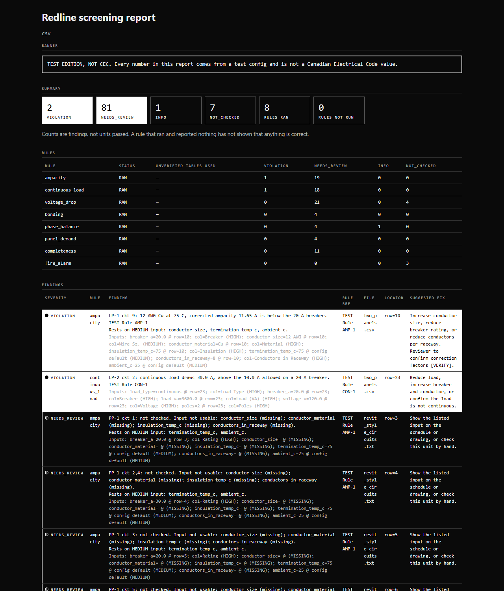

# Redline

Redline screens building electrical design packages (panel schedules and drawings) for a qualified reviewer. It flags what to look at. It never approves a package, never guesses, and never supplies a Canadian Electrical Code (CEC) value. Every code value comes from a config the reviewer fills in and verifies.

The report above was made with `redline check samples/csv --config tests/test_config/ --out report.html`. The test config holds placeholder values, which is why the banner says TEST EDITION, NOT CEC.

## What it does

Inputs:

- CSV, TXT and XLSX panel schedules.
- AutoCAD DWG and DXF drawings, read by two extractors: an AutoCAD Core Console plugin and ODA File Converter with ezdxf. `.wdp` project files are read as a list of the drawings they name.
- PDF drawing sets (vector pages with text). Scanned pages are listed as not read.
- Fire alarm plan sheets in DXF or DWG, with optional `exits.csv` and `paths.csv` files beside them.
- Revit is not supported yet.

Rules, each run on its own and each skippable with `--skip-rule ID`:

- `ampacity`
- `continuous_load`
- `voltage_drop`
- `bonding`
- `phase_balance`
- `panel_demand`
- `completeness`
- `fire_alarm`

Severities are `VIOLATION`, `NEEDS_REVIEW`, `INFO` and `NOT_CHECKED`. Severity is always written as text. A unit that was not checked is reported as not checked, never passed by silence. The report also has a "needs manual check" section and a coverage table.

Outputs: a single-file HTML report that prints cleanly to PDF from a browser, and `findings.csv` beside it. The report loads no external assets.

## What it will not do

- It does not approve a package or call one compliant.
- It does not guess a missing value. A low-confidence or missing input gives a review item, not a verdict.
- It ships no CEC values. The code tables in `config/` are empty.
- While a config table is not marked verified, every VIOLATION is shown as NEEDS_REVIEW.
- It exits 0 for any completed run, because it screens and does not gate. It exits 2 for a config failure or when no input could be read.

## Install

Python 3.12 or later.

    python -m venv .venv
    .venv\Scripts\python.exe -m pip install . -c constraints.txt

For development, use an editable install: `pip install -e ".[dev]"`.

Extras:

- `[dxf]` adds ezdxf, for DXF and the ODA route.
- `[pdf]` adds pdfplumber, for PDF sheets.
- `[dev]` adds pytest, ruff and both extras above.

The base install reads CSV, TXT and XLSX.

DWG reading needs tools you install yourself. Redline bundles none of them: AutoCAD's Core Console (`accoreconsole.exe`) with the plugin built from `extractors/acad_plugin/`, or ODA File Converter. Setup steps are in `docs/operator_guide.md`.

## Quick start

    redline check samples/csv --config tests/test_config/ --out report.html

This writes `report.html` and `findings.csv`. Other commands:

- `redline check --demo-project tests/golden/demo_project.json --config tests/test_config/ --out report.html` runs a demo project.
- `redline doctor --config config/` reports what this machine can and cannot read, as PASS, WARN, FAIL or NOT CHECKED per line. `--drawing FILE` runs a plugin smoke test. `--licences` prints the licence table.
- `redline xcheck FILE... [--batch --out DIR]` compares what the two DWG extractors read from a drawing.
- `redline gold eval DIR --config tests/test_config/` measures table reading against a transcribed set of schedules.

Options and exit codes are in `docs/operator_guide.md`.

## Configuration

`config/*.yaml` holds every code value and limit. Python holds none.

- `cec_tables.yaml`: code edition, rule references and tables. Every table starts empty and `verified: false`.
- `column_maps.yaml`: how input columns map to the data model, and tool paths.
- `fire_alarm.yaml`: fire alarm device classes and distance limits.
- `ai.yaml`: settings for the optional local AI, which is off.

The reviewer fills the values from the code book and marks each table verified. Use `--config config/` for the real config and `--config tests/test_config/` for the placeholder test config. See `docs/operator_guide.md`.

## Optional local AI

Not built yet. `config/ai.yaml` holds the planned settings: models run locally, network access is refused, and AI-derived values are never rated above medium confidence. The `check` command has no `--ai` or `--detect` flag today. Scanned PDF pages are listed as not read until this is built. The plan is in `docs/PLAN.md`.

## Project layout

    src/redline/
        cli.py, engine.py, registry.py   command line, rule runner, rule list
        model.py, findings.py, config.py data model, finding type, config loading
        rawdrawing.py                    versioned JSON contract for drawings
        rules/                           one module per rule
        extract/                         DWG extractors, write RawDrawing JSON
        parsers/                         CSV/XLSX, DXF, PDF and exits readers
        report/                          HTML and CSV output
        tools/                           doctor, gold eval, xcheck
    extractors/acad_plugin/              C# AutoCAD plugin, a thin dumper
    config/                              code values and limits
    samples/                             csv, dwg, pdf and plan samples
    tests/                               one test file per rule and parser
    docs/                                operator guide, plan, research

## Development

    pip install -e ".[dev]"
    pytest -q
    ruff check . && ruff format --check .

Tests marked `live` need AutoCAD or ODA and are skipped by default.

## Status and licence

Readers for CSV, DWG, DXF and PDF, the eight rules, the report and the tools above are built. Real-world testing on owner-supplied drawings is still open. The optional local AI and Revit support are not built.

Licence: a licence has not been chosen yet. No licence is granted until one is added.
